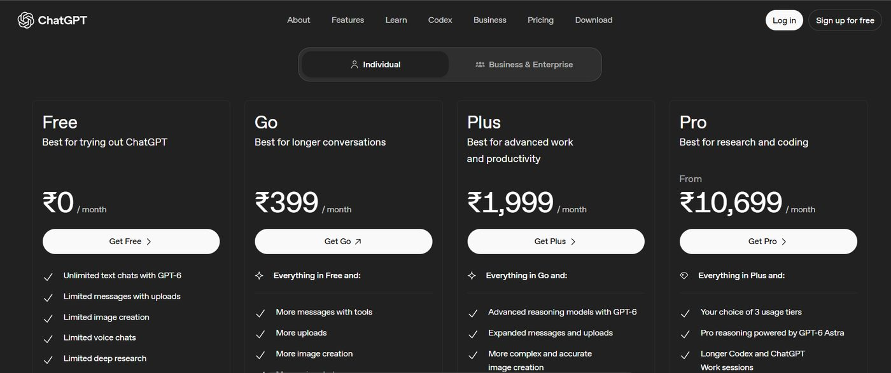
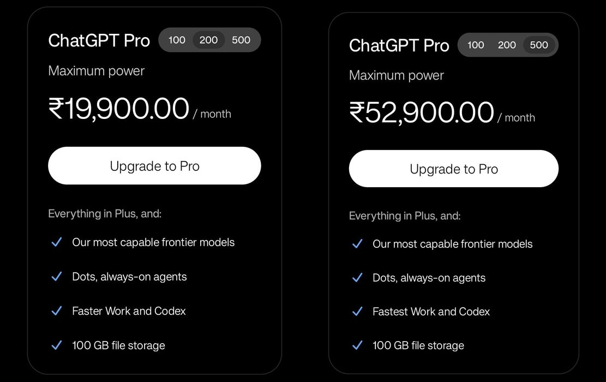

ChatGPT Plus costs ₹1,950 a month in the Android app and ₹1,999 on the website in India, a gap of ₹49. Go is ₹399 on both, and Pro starts at ₹10,699 a month with higher tiers at ₹19,900 and ₹52,900. This guide lists every price we saw, what each plan adds, and what we could not confirm.

> **How we checked.** We read these prices on 20 November 2026, on the ChatGPT website and in the Android app, and show screenshots below. Plans and prices change, so check your own screen before you pay.

[[toc]]

## ChatGPT prices in India at a glance

All prices are in Indian rupees per month, for individual plans.

| Plan | Website (chatgpt.com) | Android app | Difference |
|---|---|---|---|
| Free | ₹0 | ₹0 | Same |
| Go | ₹399 | ₹399.00 | Same |
| Plus | ₹1,999 | ₹1,950.00 | App is ₹49 a month cheaper |
| Pro, 100 tier | "From ₹10,699" | ₹10,699.00 | Same |
| Pro, 200 tier | Tier price not shown on the page we saw | ₹19,900.00 | |
| Pro, 500 tier | Tier price not shown on the page we saw | ₹52,900.00 | |

Paid monthly for a year, Plus costs ₹23,988 on the website and ₹23,400 in the app, so the app saves ₹588 a year. Go comes to ₹4,788 a year.

## What the website shows

The pricing page has an Individual tab and a Business and Enterprise tab. We checked only Individual. It lists Free at ₹0, Go at ₹399, Plus at ₹1,999, and Pro "From ₹10,699" with "Your choice of 3 usage tiers".

## What the Android app shows

In the Android app, Go is ₹399.00, Plus is ₹1,950.00 and Pro is ₹10,699.00 on the 100 tier. Pro has a switch labelled 100, 200 and 500, which moves the price to ₹19,900.00 and ₹52,900.00. The numbers are the tiers' US dollar prices, as the next section explains.

## What the Pro 100, 200 and 500 tiers mean

The numbers are the US dollar monthly price. OpenAI's help article on Pro tiers lists Pro 100 at $100, Pro 200 at $200 and Pro 500 at $500. In India the same tiers cost ₹10,699, ₹19,900 and ₹52,900, which is about ₹107, ₹99.50 and ₹105.80 for each US dollar in the name, so the rupee prices are not a single fixed conversion.

What changes as you go up:

- **More usage.** OpenAI's help article says Pro 200 includes more usage than Pro 100, and Pro 500 offers the highest included usage of the three.
- **Ultrafast.** OpenAI's table lists Ultrafast, a fast mode of GPT-6 Astra, on Pro 500 only.
- **No fixed multiples.** Other sites that read the help article report that it gives no multiple of Plus usage for any Pro tier. Multiples have been quoted and have changed: OpenAI's launch of the $100 tier in April said 5x Plus, with 20x for the $200 tier, and reports from the launch of Pro 500 in September put it at 25x. A post by OpenAI's Thibault Sottiaux on 8 November 2026, as reported by other sites, gave 10x, 20x and 50x for Work and Codex, with no five-hour limit on the Pro plans. We have not seen that post ourselves.

Treat any multiple as unstable, and check the usage listed on your own plan screen before you pick a tier.

.")

## How the plans differ

This is what the screens list. We did not test the limits.

- **Free:** unlimited text chats with GPT-6, and limited messages with uploads, image creation, voice chats and deep research.
- **Go:** everything in Free, with more messages with tools, more image creation, and more memory and storage.
- **Plus:** everything in Go, with advanced reasoning models with GPT-6, expanded messages and uploads, more complex and accurate image creation, and scheduled tasks and automations.
- **Pro:** everything in Plus, with the most capable frontier models, "always-on agents" and 100 GB of file storage. The website adds Pro reasoning powered by GPT-6 Astra and longer Codex and ChatGPT Work sessions. Work and Codex usage rises across the tiers: "more" on 100, "faster" on 200 and "fastest" on 500.

## What the gaps cost

Using the app prices, Go is ₹1,551 a month below Plus, and Pro on the 100 tier is ₹8,749 a month above Plus. On the website, Go is ₹1,600 below Plus.

## Is ChatGPT Go still free in India?

A summary of OpenAI's release notes says the 12-month free Go offer for India ended on 21 January 2026. We saw Go at ₹399 on both the website and the app.

## How to pay

Another site reports that UPI works for Go and Plus but not for Pro. We did not test checkout, so check the payment options on your own screen.

## What we could not confirm

- **GST.** Neither the website nor the app screens we saw say whether the price includes GST or whether it is added at checkout. Check the total on the payment screen, and ask your accountant if you need GST input credit.
- **iPhone.** The app price is ₹49 below the website. We checked the Android app only, and prices can differ on the App Store.
- **Business and Enterprise.** We did not check these plans.

## ChatGPT subscription or the API?

Plus, Pro and Go are flat monthly plans for using ChatGPT. The API is a separate product billed by the token, for building your own tool or running a fixed workload. To compare API prices across providers, see [how to compare LLM API prices fairly](post:compare-llm-api-prices). Here are the current OpenAI API prices, which update automatically.

[[api-prices OpenAI]]

To estimate a bill for your own workload, use the [Cost Forecaster](tool:cost-forecaster), and compare other providers on [Model Prices](tool:model-prices). For Claude and Gemini, see [ChatGPT vs Claude vs Gemini price in India](post:chatgpt-vs-claude-vs-gemini-price-in-india).

## Frequently asked questions

### How much does ChatGPT Plus cost in India?

₹1,950.00 a month in the Android app and ₹1,999 on the website when we checked on 20 November 2026.

### How much is ChatGPT Go in India?

₹399 a month on both the website and the app.

### How much is ChatGPT Pro in India?

It depends on the tier. We saw ₹10,699, ₹19,900 and ₹52,900 a month for the 100, 200 and 500 tiers. The website shows "From ₹10,699".

### What do ChatGPT Pro 100, 200 and 500 mean?

The numbers are the tiers' US dollar monthly prices. Each step up includes more usage, and only Pro 500 includes Ultrafast. OpenAI's exact usage multiples have changed, so check your plan screen.

### Is the ChatGPT Free plan free in the app?

Yes. It shows ₹0 in the Android app as well as on the website.

### Is ChatGPT cheaper in the app?

For Plus, yes, by ₹49 a month in the Android app in our check. Go and the Pro 100 tier were the same in both places.

### Does the ChatGPT price include GST?

We could not tell. The screens we saw do not say, so check the total at checkout.

### Is ChatGPT Go free in India?

Not any more. A summary of OpenAI's release notes says the 12-month free offer ended on 21 January 2026.

Sources:
- [ChatGPT price in India, read 17 Nov 2026 (llmwise), for the Go free-offer end date and UPI support](https://llmwise.ai/prices/india/chatgpt)
- [About ChatGPT Pro tiers (OpenAI Help Center)](https://help.openai.com/en/articles/9793128-what-is-chatgpt-pro-plans)
- [OpenAI adds new $100/month ChatGPT subscription tier (MacRumors, 9 Apr 2026)](https://www.macrumors.com/2026/04/09/openai-pro-subscription-tiers/)
- [ChatGPT Pro 500, the $500 plan (Sebastien Dubois, 29 Sep 2026)](https://www.dsebastien.net/2026-09-29-chatgpt-pro-500-the-500-plan-that-came-with-a-pro-200-cut/)
- [ChatGPT Pro usage limits, citing the 8 Nov 2026 post (CellCog)](https://cellcog.ai/blog/chatgpt-pro-usage-vs-plus/)
