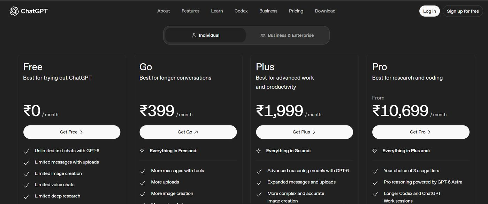
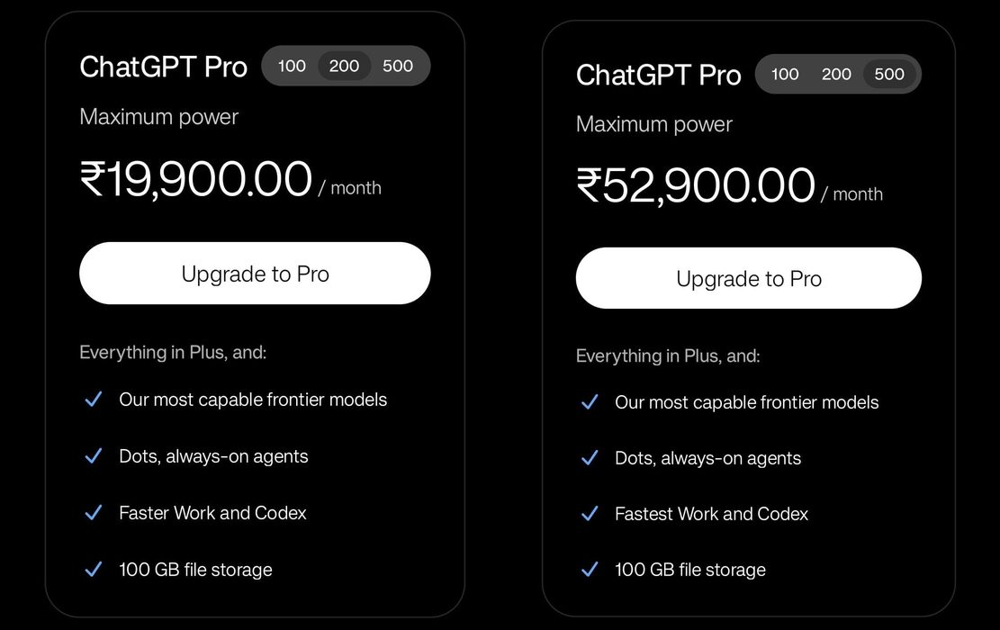
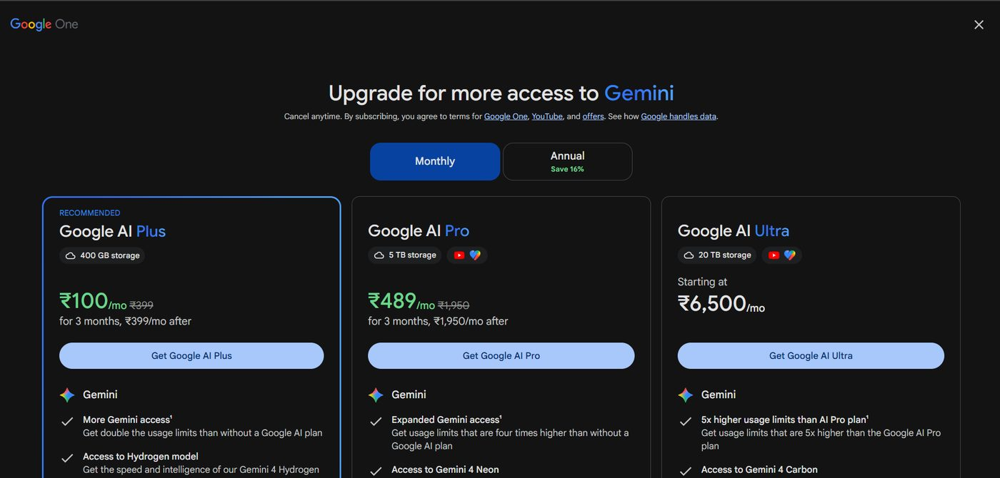
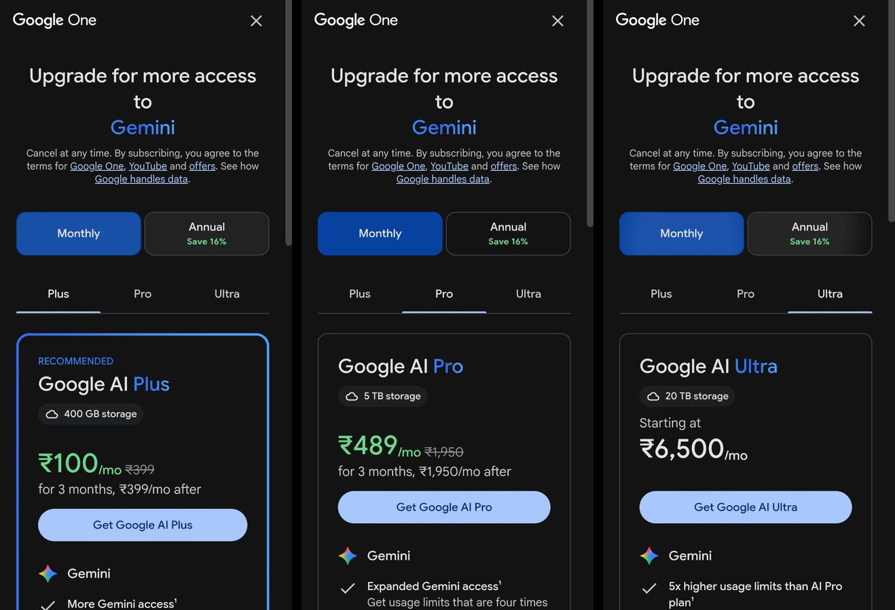

In India, ChatGPT, Claude and Gemini each sell a main paid plan at about ₹2,000 a month, and the exact price depends on where you subscribe. ChatGPT Plus and Google AI Pro are both ₹1,950 in the places we checked, Claude Pro is ₹1,999 in the Android app and ₹2,399 on the website, and ChatGPT and Google also sell a ₹399 entry plan. This guide puts the rupee prices side by side and shows what we could not confirm.

> **How we checked.** We read the ChatGPT and Google prices on 20 November 2026, on the websites and on a phone, and the Claude prices on 12 November 2026 (see [Claude Pro price in India](post:claude-pro-price-india)). Screenshots are below. Plans and offers change often, so check your own screen before you pay.

[[toc]]

## Prices in India at a glance

All prices are per month, in rupees, for individual plans.

| Level | ChatGPT | Claude | Google (Gemini) |
|---|---|---|---|
| Free | ₹0 | ₹0 | ₹0 |
| Entry paid | Go: ₹399 | No plan between Free and Pro | AI Plus: ₹399 after the intro offer |
| Main paid plan | Plus: ₹1,950 in the app, ₹1,999 on the website | Pro: ₹1,999 in the Android app, ₹2,399 on the website | AI Pro: ₹1,950 after the intro offer |
| High usage | Pro: ₹10,699 | Max: ₹12,493.75 in the app; website from ₹11,999 | AI Ultra: from ₹6,500 |
| Highest usage | Pro tiers at ₹19,900 and ₹52,900 | Ultra: ₹24,987.50 in the app | Higher Ultra tier reported at ₹19,500 |

The tiers are not like for like. Each company limits usage in its own way, so a higher price does not always buy more of the same thing.

## The main plan, compared

The plans most people compare are ChatGPT Plus, Claude Pro and Google AI Pro.

- **In the apps:** ChatGPT Plus and Google AI Pro are both ₹1,950. Claude Pro is ₹1,999, which is ₹49 more.
- **On the websites:** Google AI Pro is ₹1,950, ChatGPT Plus is ₹1,999 (₹49 more) and Claude Pro is ₹2,399 (₹449 more than Google).

Where you subscribe matters about as much as which one you pick: ChatGPT's app price is ₹49 below its website price, and Claude's is ₹400 below.

## ChatGPT in India

- **Go** is ₹399 a month on the website and in the app. A summary of OpenAI's release notes says the 12-month free Go offer for India ended on 21 January 2026.
- **Plus** is ₹1,999 on the website and ₹1,950.00 in the Android app.
- **Pro** shows "From ₹10,699" on the website, with a choice of three usage tiers. In the app they are labelled 100, 200 and 500, and cost ₹10,699, ₹19,900 and ₹52,900 a month. The numbers are the tiers' US dollar prices, and higher tiers include more usage (see the full guide).
- **UPI** is reported to work for Go and Plus but not for Pro. We did not test payment.

.")

Full guide: [ChatGPT price in India](post:chatgpt-price-in-india).

## Claude in India

- **Pro** is ₹2,399 a month on the website and ₹1,999 in the Android app. Yearly, it is ₹23,999 on the website and ₹21,600 in the app.
- **Max** is ₹12,493.75 a month in the app. The website lists Max and Ultra together from ₹11,999.
- **Ultra** is ₹24,987.50 in the app, labelled "1-month access".

Full details, screenshots and the GST caveat are in [Claude Pro price in India](post:claude-pro-price-india).

## Google Gemini in India

Full guide: [Gemini price in India](post:gemini-price-in-india).

Google sells Gemini through its Google AI plans, which also include cloud storage.

- **Google AI Plus** has a list price of ₹399 a month. Our screen showed an intro offer of ₹100 a month for 3 months, then ₹399. The plan includes 400 GB of storage.
- **Google AI Pro** has a list price of ₹1,950 a month. Our screen showed ₹489 a month for 3 months, then ₹1,950. It includes 5 TB of storage.
- **Google AI Ultra** starts at ₹6,500 a month with 20 TB of storage and 5x the usage limits of AI Pro. A higher Ultra tier at ₹19,500 is reported by another site, but we did not see it.
- **Annual billing** is offered for Plus and Pro, at ₹3,000 for the first year of Plus and ₹19,500 a year for Pro. Ultra is monthly only.

On the intro offers, the Plus deal saves ₹897 over three months (₹299 a month) and the Pro deal saves ₹4,383 (₹1,461 a month). Intro offers may depend on your account, so yours may differ.

## What we could not confirm

- **GST.** Claude's website price says it includes GST. None of the ChatGPT or Google screens we saw says whether GST is included or added at checkout, so check the total on the payment screen.
- **Payment methods.** We did not test checkout, so UPI support for ChatGPT is as reported by another site.
- **Store differences.** ChatGPT's Android app price is ₹49 below its website price. Google's phone and desktop screens matched. Prices can also differ between Google Play and the App Store, so check yours.
- **Changes.** Plans, prices and offers change often.

## Subscription or API?

These are flat monthly plans for using the apps. If you are building something or running a fixed job, the API bills by the token instead. See [how to compare LLM API prices fairly](post:compare-llm-api-prices), compare models on [Model Prices](tool:model-prices), and estimate a monthly bill with the [Cost Forecaster](tool:cost-forecaster).

## Frequently asked questions

### Is ChatGPT Plus cheaper than Claude Pro in India?

In the apps, yes: ChatGPT Plus is ₹1,950 and Claude Pro is ₹1,999. On the websites, ChatGPT Plus is ₹1,999 and Claude Pro is ₹2,399.

### Is Google AI Pro cheaper than ChatGPT Plus in India?

Google AI Pro is ₹1,950 a month. ChatGPT Plus is ₹1,950 in the Android app and ₹1,999 on the website, so Google is the same as the app and ₹49 lower than the website. Google AI Pro also includes 5 TB of storage.

### What is the cheapest paid AI plan in India?

ChatGPT Go and Google AI Plus are both ₹399 a month at list price. Google showed an intro offer of ₹100 a month for the first 3 months. Claude has no paid plan below Pro.

### How much is ChatGPT Pro in India?

It depends on the tier. We saw ₹10,699, ₹19,900 and ₹52,900 a month for the 100, 200 and 500 tiers.

### Is ChatGPT Go still free in India?

A summary of OpenAI's release notes says the 12-month free Go offer for India ended on 21 January 2026, and ₹399 a month applies. We saw ₹399 on our screens.

### Do these prices include GST?

Claude's website price says it includes GST. The ChatGPT and Google screens we saw do not say, so check the total at checkout.

Sources:
- [ChatGPT price in India, read 17 Nov 2026 (llmwise), for the Go free-offer end date and UPI support](https://llmwise.ai/prices/india/chatgpt)
- [Google AI plans in India, prices checked 6 Nov 2026 (Ayorahub), for the higher Ultra tier](https://ayorahub.in/google-gemini-plans-india-ai-plus-pro-ultra/)
