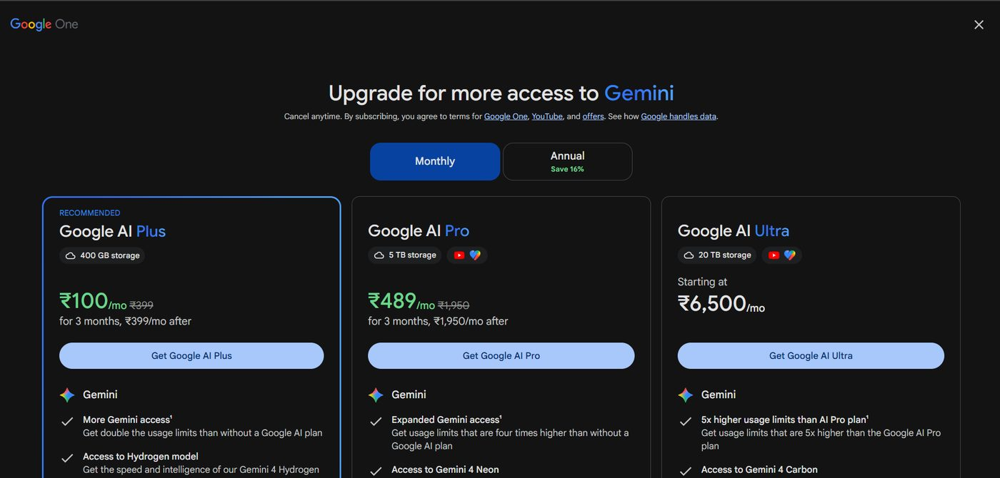
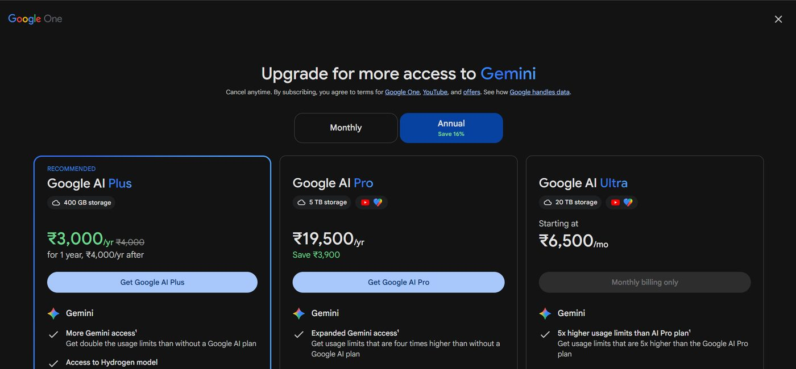
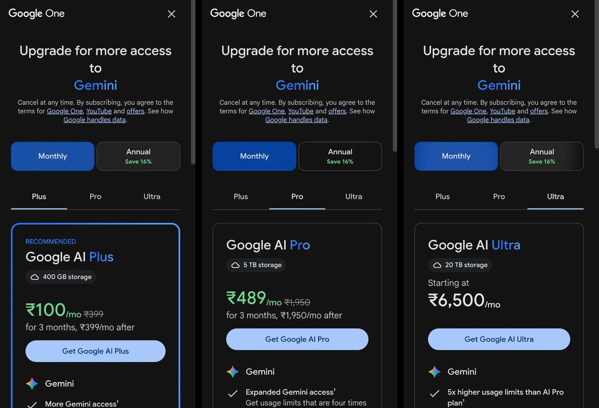

Gemini's paid plans in India are Google AI Plus at ₹399 a month, Google AI Pro at ₹1,950 and Google AI Ultra from ₹6,500. When we checked, Google was also showing intro offers of ₹100 a month for Plus and ₹489 a month for Pro, each for the first 3 months, and annual billing at ₹19,500 a year for Pro. This guide lists what we saw, what each plan includes, and what we could not confirm.

> **How we checked.** We read these prices on 20 November 2026 on the Google One upgrade page, on a desktop and on a phone. Screenshots are below. Plans and offers change, so check your own screen before you pay.

[[toc]]

## Google AI plan prices in India at a glance

All prices are in Indian rupees per month, billed monthly.

| Plan | List price | Intro offer we saw | Storage | Usage, as the screen words it |
|---|---|---|---|---|
| Google AI Plus | ₹399 | ₹100 a month for 3 months | 400 GB | Double the usage limits than without a Google AI plan |
| Google AI Pro | ₹1,950 | ₹489 a month for 3 months | 5 TB | Four times higher usage limits than without a Google AI plan |
| Google AI Ultra | From ₹6,500 | None shown | 20 TB | 5x higher usage limits than AI Pro |

The upgrade page is titled "Upgrade for more access to Gemini" and sits inside Google One, which is why storage is part of every plan.

## What the intro offers save

If you stay on the plan and pay monthly, the 3-month offers work out like this over a first year:

- **AI Plus:** ₹300 for the first 3 months plus ₹3,591 for the next 9, a total of ₹3,891 against ₹4,788 at list price. That saves ₹897.
- **AI Pro:** ₹1,467 for the first 3 months plus ₹17,550 for the next 9, a total of ₹19,017 against ₹23,400 at list price. That saves ₹4,383.

Intro offers can depend on your account, and the offer on your screen may differ. After the offer ends, the list price applies.

## What the gaps cost

At list price, AI Pro is ₹1,551 a month above AI Plus, and AI Ultra starts ₹4,550 above AI Pro.

## Annual prices

The page has a Monthly and Annual switch, and the Annual option is labelled "Save 16%". On the Annual view we saw:

| Plan | Annual price on our screen | 12 months at the monthly list price | What you save | Per month equivalent |
|---|---|---|---|---|
| Google AI Plus | ₹3,000 for the first year (struck-through ₹4,000), then ₹4,000 a year | ₹4,788 | ₹788 a year at ₹4,000, or ₹1,788 in the first year | ₹250 in the first year, then about ₹333 |
| Google AI Pro | ₹19,500 a year | ₹23,400 | ₹3,900 (the screen says "Save ₹3,900") | ₹1,625 |
| Google AI Ultra | Monthly billing only | | | |

A few comparisons from these figures:

- **Plus:** paying monthly with the 3-month intro offer costs ₹3,891 over the first year, so the ₹3,000 annual intro is ₹891 lower.
- **Pro:** paying monthly with the 3-month intro offer costs ₹19,017 over the first year, ₹483 less than the ₹19,500 annual price. The annual price showed no intro offer, so from the second year annual is ₹3,900 cheaper than monthly at list price.
- **Ultra:** the button reads "Monthly billing only", so there is no annual option.

The annual figures assume you keep the plan for the full year. Annual plans are paid up front, which we did not test, so check the refund and cancellation terms on your own screen.

## What the desktop shows

The desktop page shows all three plans side by side. The first screenshot is the Monthly view, and the second is the Annual view.

## What the phone shows

On a phone, the same plans sit under Plus, Pro and Ultra tabs, with the same prices and offers.

## How the plans differ

This is what the screens list, and we did not test the limits.

- **AI Plus:** 400 GB of storage, double the usage limits of using Gemini without a Google AI plan, and access to a Gemini 4 model the screen calls Hydrogen.
- **AI Pro:** 5 TB of storage, four times the usage limits, expanded Gemini access, and access to Gemini 4 Neon.
- **AI Ultra:** 20 TB of storage, 5x the usage limits of AI Pro, and access to Gemini 4 Carbon.

Model names and benefits are Google's wording on the day we looked and may change.

## How the line-up has changed

A Business Standard report from December 2025 said Google AI Plus launched in India at ₹399 a month with an introductory ₹199 for new users for six months, and quoted AI Pro at ₹1,950 and AI Ultra at ₹24,500. The Plus and Pro list prices match what we saw. The Ultra starting price on our screen is now ₹6,500, and the intro offers are different, so the plan details have changed since launch.

## What we could not confirm

- **GST.** The screens we saw do not say whether prices include GST or whether it is added at checkout. Check the total on the payment screen.
- **Payment methods.** We did not test checkout, so we cannot say which methods, including UPI, are offered.
- **Higher Ultra tier.** Another site reports an Ultra tier at ₹19,500 a month. We saw only "starting at ₹6,500".
- **App store.** We did not check whether prices differ if you subscribe through an app store.

## Google AI plan or the Gemini API?

Google AI Plus, Pro and Ultra are monthly plans for using Gemini and Google's apps. The Gemini API is a separate product billed by the token, for building your own tool. To compare API prices across providers, see [how to compare LLM API prices fairly](post:compare-llm-api-prices). Here are the current Google API prices, which update automatically.

[[api-prices Google]]

To estimate a bill for your own workload, use the [Cost Forecaster](tool:cost-forecaster), and compare other providers on [Model Prices](tool:model-prices). For ChatGPT and Claude, see [ChatGPT vs Claude vs Gemini price in India](post:chatgpt-vs-claude-vs-gemini-price-in-india).

## Frequently asked questions

### How much is Google AI Pro in India?

₹1,950 a month at list price, or ₹19,500 a year on annual billing. On 20 November 2026 our screen showed ₹489 a month for the first 3 months on the monthly plan.

### How much is Google AI Plus in India?

₹399 a month at list price, with an intro offer of ₹100 a month for 3 months on our screen. Annual billing was ₹3,000 for the first year, then ₹4,000 a year.

### How much is Google AI Ultra in India?

It starts at ₹6,500 a month, with monthly billing only. We did not see an intro offer.

### Does Google AI Pro include storage?

Yes. The screen lists 5 TB for AI Pro, 400 GB for AI Plus and 20 TB for AI Ultra.

### Is annual billing cheaper?

Yes, on our screen. Google AI Pro is ₹19,500 a year against ₹23,400 for 12 months at the monthly price, a saving of ₹3,900. Google AI Plus is ₹3,000 for the first year and ₹4,000 a year after, against ₹4,788. Google AI Ultra is monthly billing only.

### Do the Google AI prices include GST?

We could not tell. The screens we saw do not say, so check the total at checkout.

Sources:
- [Google releases new budget AI Plus plan in India (Business Standard, December 2025)](https://www.business-standard.com/technology/tech-news/google-ai-plus-plan-launched-india-price-features-storage-vs-chatgpt-go-125121000424_1.html)
- [Google AI plans in India, prices checked 6 Nov 2026 (Ayorahub), for the higher Ultra tier](https://ayorahub.in/google-gemini-plans-india-ai-plus-pro-ultra/)
